<div align="center">
  <p>
    
    &nbsp;&nbsp;&nbsp;
    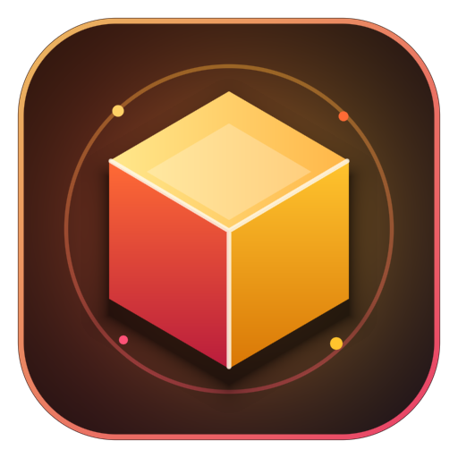
  </p>
  <h1>Lumora Launcher</h1>
  <p><strong>Modern, fast, and 100% open-source Minecraft Launcher — Built with Electron</strong></p>
  <p>
    
    
    
    
  </p>
  <p>
    <a href="https://github.com/lumora-launcher/lumora-launcher/releases">⬇ Download Releases</a> ·
    <a href="#-english">🇬🇧 English</a> ·
    <a href="#-türkçe">🇹🇷 Türkçe</a> ·
    <a href="#-5-color-themes--5-renk-teması">🎨 Themes</a> ·
    <a href="https://github.com/lumora-launcher/lumora-launcher/issues">🐞 Report Issue</a>
  </p>
</div>

---

## 📸 UI & Feature Showcase / Arayüz & Özellik Vitrini

<p align="center">
  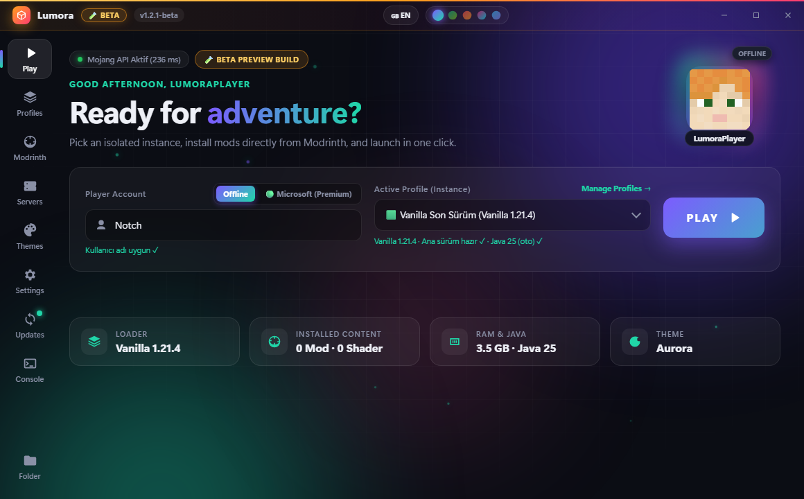
</p>

<table>
  <tr>
    <td width="50%" align="center">
      <strong>🧩 Isolated Instances & Managers</strong><br/>
      <sub>Mods, Shaders, Resource Packs, World Backups & Config Editor</sub><br/><br/>
      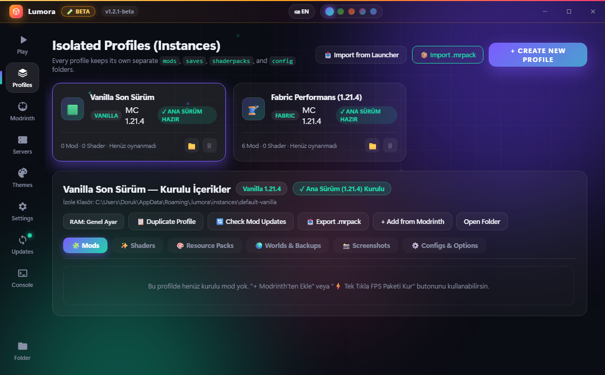
    </td>
    <td width="50%" align="center">
      <strong>🟢 Modrinth Content Store</strong><br/>
      <sub>1-Click Mods, Modpacks (.mrpack), Shaders & Auto-Dependencies</sub><br/><br/>
      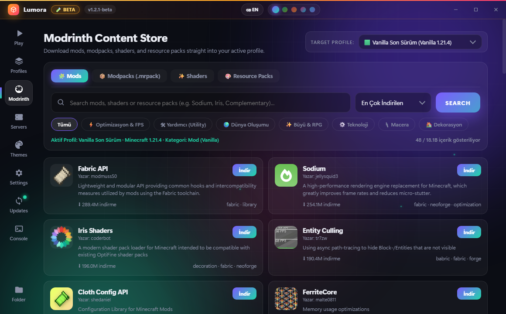
    </td>
  </tr>
  <tr>
    <td width="50%" align="center">
      <strong>🌐 Live Server Ping & Quick Join</strong><br/>
      <sub>Real-time player count, latency (ms), MOTD & direct launch</sub><br/><br/>
      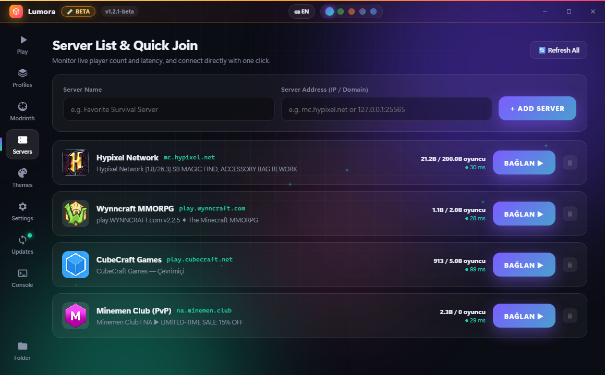
    </td>
    <td width="50%" align="center">
      <strong>👕 Built-in 3D Skin Studio (Alex & Steve)</strong><br/>
      <sub>True 3px slim & 4px classic renderer, Mojang lookup, local & MS upload</sub><br/><br/>
      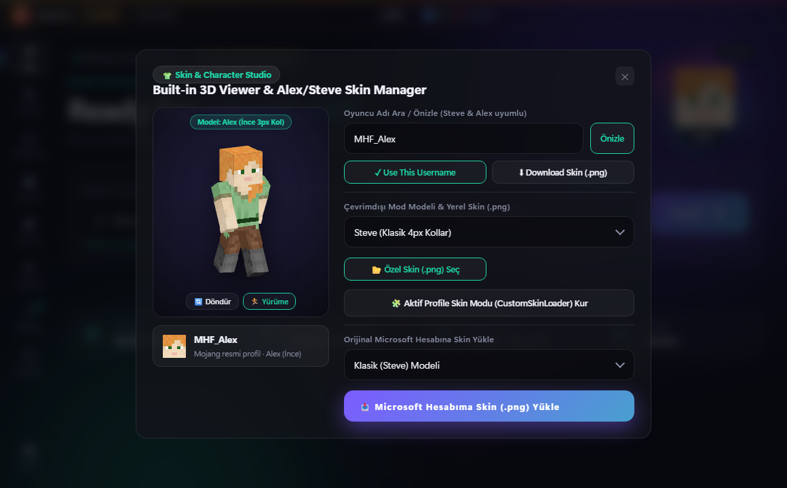
    </td>
  </tr>
</table>

---

## 🎨 5 Color Themes / 5 Renk Teması

<table>
  <tr>
    <td width="33.3%" align="center">
      <strong>🌌 Aurora (Purple &amp; Teal)</strong><br/>
      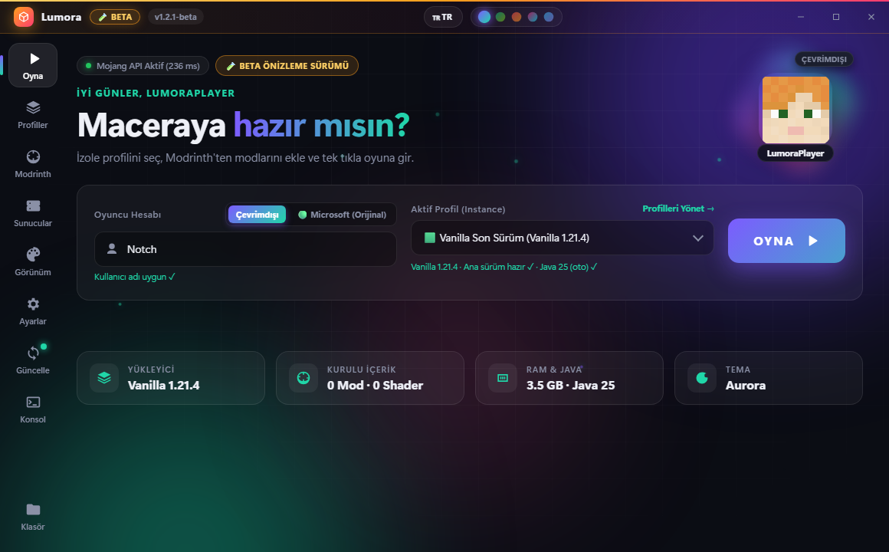
    </td>
    <td width="33.3%" align="center">
      <strong>💚 Emerald / Zümrüt</strong><br/>
      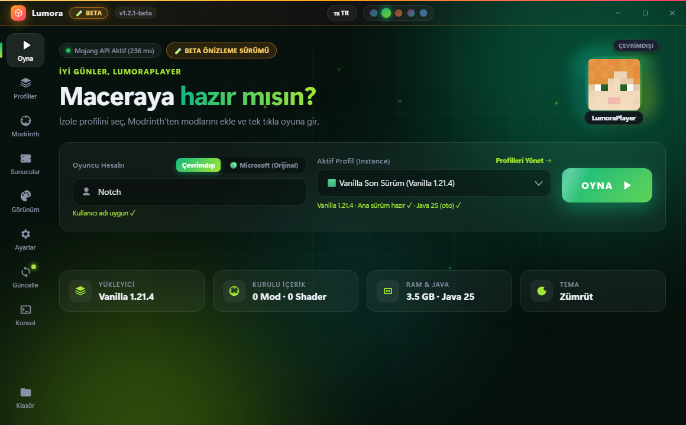
    </td>
    <td width="33.3%" align="center">
      <strong>🔥 Nether (Crimson &amp; Magma)</strong><br/>
      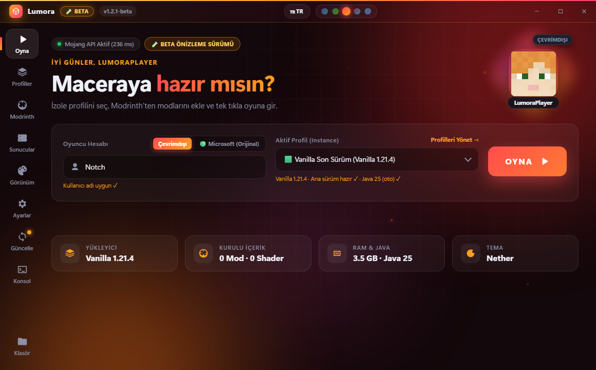
    </td>
  </tr>
  <tr>
    <td width="50%" align="center">
      <strong>⚡ Cyberpunk (Neon Pink &amp; Cyan)</strong><br/>
      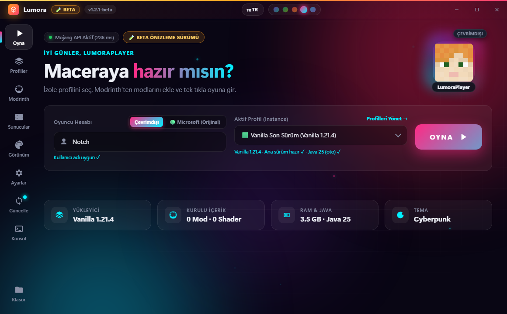
    </td>
    <td width="50%" align="center">
      <strong>❄️ Frost / Buzul (Sapphire Ice)</strong><br/>
      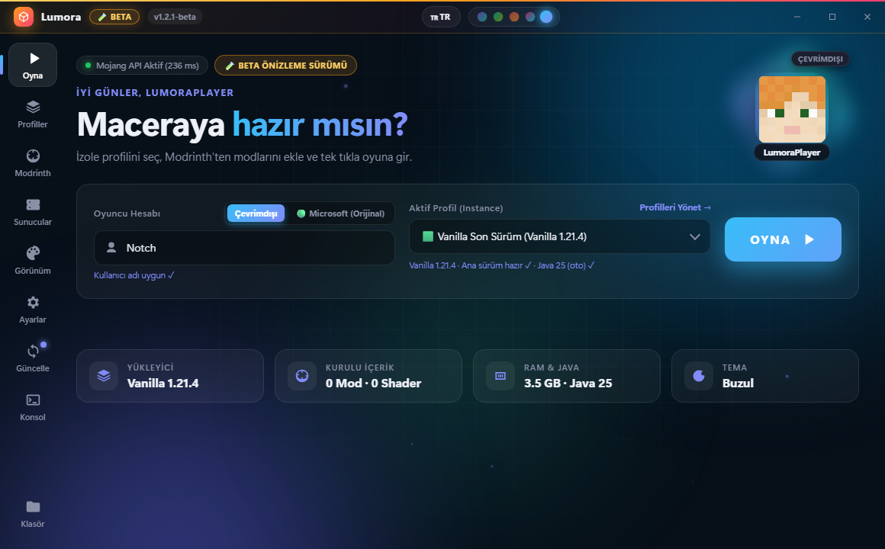
    </td>
  </tr>
</table>

---

## 🇬🇧 English

### ✨ Key Features

- **🗂️ Isolated Profile (Instance) Management:** Keep **Fabric**, **NeoForge**, **Forge**, **OptiFine**, **Quilt**, and **Vanilla** profiles completely separated with dedicated `mods`, `saves`, `shaderpacks`, and `config` directories — plus **1-Click Profile Duplication**, per-profile **RAM limits**, and automatic base Vanilla verification.
- **🟢 Integrated Modrinth Store & `.mrpack` Support:** Browse, search, and install **Mods**, **Modpacks (`.mrpack`)**, **Shaders**, and **Resource Packs** without leaving the launcher. Automatically installs required dependencies (*Fabric API*, *Cloth Config*, etc.), checks SHA-1 mod updates, and supports `.mrpack` import/export.
- **📥 Launcher Import Wizard:** Migrate existing profiles, mods, and worlds from official `.minecraft`, **CurseForge**, **Prism Launcher**, **MultiMC**, and **Modrinth App** in one click.
- **👕 Built-in 3D Canvas Skin Studio (Steve 4px & Alex 3px):** Live Mojang API lookup, automatic 3px slim (*Alex*) vs 4px classic (*Steve*) arm rendering, legacy `64×32` hat fix, local `.png` skin picker, **1-click `CustomSkinLoader` install**, `.png` download, and direct Microsoft skin upload.
- **⚙️ In-App Config & `options.txt` Editor:** Edit `options.txt`, `optionsof.txt`, and mod `config/` files (`.json`, `.toml`, `.properties`, `.cfg`, `.yml`) right inside the launcher.
- **🌐 Live Server List & QuickPlay:** Inspect real-time server MOTD, icon, ping (ms), and player counts via Minecraft SLP, and join directly skipping the main menu.
- **🌍 World Manager, ZIP Backups & Screenshot Gallery:** Launch directly into singleplayer worlds, create/restore `.zip` backups, and browse in-game `F2` screenshots.
- **🔐 Microsoft (Xbox Live) & Offline Auth:** Sign in with your official Microsoft account (encrypted locally via Windows DPAPI `safeStorage`) or play in offline mode with model/UUID parity support.
- **🔍 Smart Crash Analyzer & `mclo.gs` Log Share:** Detects missing library mods, Java mismatches, Mixin conflicts, or RAM limits in `latest.log` / `crash-reports`, and uploads token-redacted logs to `mclo.gs`.
- **🌍 7 Built-in Languages:** Instant switching from the title bar between **🇹🇷 Türkçe**, **🇬🇧 English**, **🇩🇪 Deutsch**, **🇪🇸 Español**, **🇷🇺 Русский**, **🇫🇷 Français**, and **🇧🇷 Português**.
- **🎨 Customizable UI:** 5 color themes (*Aurora*, *Emerald*, *Nether*, *Cyberpunk*, *Frost*), 3 layouts (*Modern Cards*, *Cinematic Dock*, *Minimal Focus*), animated splash intro, and JVM optimization presets (*Aikar's Flags*, *Low-End*).
- **🔒 Silent Official Auto-Updater:** Locked strictly to the official `lumora-launcher/lumora-launcher` GitHub repository with SHA-512 verification and silent background installation.

### 🧪 Separate Stable & Beta Channels

Lumora can be packaged from the same codebase as **two independent Windows applications** that install side-by-side without overwriting each other:
- **Stable (`com.lumora.launcher`):** Purple/Teal cube icon, `Lumora Launcher`.
- **Beta (`com.lumora.launcher.beta`):** Solar Amber/Orange cube icon, `Lumora Launcher Beta`, with distinct `BETA` UI badges and pre-release update detection.

### 🛠️ Developer Setup

```powershell
# Install dependencies
npm.cmd install

# Run in development mode
npm.cmd start

# Build Windows NSIS installer (.exe)
npm.cmd run dist:stable   # Stable build (Lumora-Launcher-Setup-x.x.x.exe)
npm.cmd run dist:beta     # Beta build (Lumora-Launcher-Beta-Setup-x.x.x-beta.exe)
```

---

## 🇹🇷 Türkçe

### ✨ Neler Var? (v1.2.1-beta)

- **🗂️ İzole Profil (Instance) Yönetimi:** Ana oyun klasörünü bozmadan **Fabric**, **NeoForge**, **OptiFine**, **Forge**, **Quilt** ve **Vanilla** profillerini birbirinden bağımsız `mods`, `saves`, `shaderpacks` ve `config` klasörlerinde tut; tek tıkla **Profili Çoğalt**, profile özel RAM seç ve ana sürümü otomatik denetle.
- **🟢 Modrinth İçerik Mağazası & `.mrpack` Desteği:** Tarayıcıya ihtiyaç duymadan **Mod**, **Modpack (`.mrpack`)**, **Shader** ve **Kaynak Paketi** ara, gerekli bağımlılıklarıyla (*Fabric API* vb.) birlikte tek tıkla kur ve `.mrpack` içe/dışa aktar.
- **📥 Başka Launcher'dan Profil Göçü:** Mevcut `.minecraft`, **CurseForge**, **Prism Launcher**, **MultiMC** ve **Modrinth App** profillerini tek tıkla Lumora'ya kopyala.
- **👕 Dahili 3B Skin & Karakter Stüdyosu (Steve 4px & Alex 3px):** Resmi Mojang API sorgusu, otomatik **Alex (3px ince kol)** / **Steve (4px klasik kol)** 3B çizim, eski `64×32` şapka siyahlığı düzeltmesi, bilgisayardan özel `.png` seçme, tek tıkla `CustomSkinLoader` kurulumu ve Microsoft hesabına doğrudan skin yükleme.
- **⚙️ Uygulama İçi Config & `options.txt` Düzenleyici:** Profilin `options.txt` ve `config/` altındaki (`.json`, `.toml`, `.properties`, `.cfg`, `.yml`) dosyalarını doğrudan arayüzden düzenle.
- **🌐 Canlı Sunucu Listesi & Tek Tıkla Bağlan (`QuickPlay`):** Sunucuların canlı oyuncu sayısını, ping (ms) süresini ve MOTD açıklamasını gör; tek tıkla doğrudan bağlan.
- **🌍 Dünya (`saves`) Yöneticisi, ZIP Yedekleme & Ekran Görüntüleri:** Tek oyunculu dünyalarını `.zip` olarak yedekle/geri yükle ve `F2` ekran görüntülerini galeriden incele.
- **🔐 Microsoft (Xbox Live) & Çevrimdışı Hesap Desteği:** Resmi Microsoft oturumları Windows DPAPI (`safeStorage`) ile şifrelenerek saklanır.
- **🔍 Akıllı Çökme Analizcisi & `mclo.gs` Log Paylaşımı:** Çökme sebeplerini Türkçe açıklar ve token bilgileri gizlenmiş logu tek tıkla `mclo.gs`'e yükler.
- **🌍 7 Dil Desteği:** Üst başlıktan anında **🇹🇷 Türkçe**, **🇬🇧 English**, **🇩🇪 Deutsch**, **🇪🇸 Español**, **🇷🇺 Русский**, **🇫🇷 Français**, **🇧🇷 Português** arası geçiş yap.
- **🧪 Normal & Beta Ayrı Kurulumlar:** Beta sürümleri altın-kehribar simgesi, `BETA` arayüz rozetleri ve ayrı Windows kurulum kimliğiyle (`com.lumora.launcher.beta`) normal sürümün üzerine yazmadan kurulur.

---

## ⚖️ Disclaimer / Yasal Uyarı

> **NOT AN OFFICIAL MINECRAFT PRODUCT. NOT APPROVED BY OR ASSOCIATED WITH MOJANG OR MICROSOFT.**

- **Lumora Launcher** is a 100% independent, original, and open-source project licensed under the **MIT License**. It has **no affiliation, partnership, sponsorship, or agreement** with **Microsoft Corporation** or **Mojang Studios**.
- **Lumora Launcher**, tamamen özgün olarak geliştirilmiş bağımsız ve açık kaynaklı bir yazılımdır. **Microsoft Corporation** veya **Mojang Studios** ile hiçbir resmi anlaşması, ortaklığı veya bağlantısı bulunmamaktadır.
- "Minecraft" and all associated assets belong to Microsoft Corporation / Mojang Studios. Official Microsoft authentication communicates directly with Microsoft/Xbox Live OAuth2 and Minecraft Services endpoints; no credentials or tokens are ever sent to any third-party server.

## 📄 License / Lisans

Released under the [MIT License](LICENSE).
