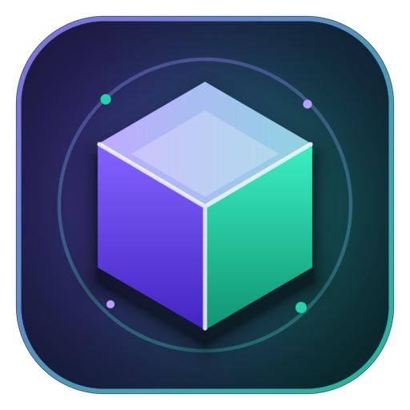

<div align="center">
  
  <h1>Lumora Launcher</h1>
  <p><strong>Modern, hızlı ve tamamen açık kaynaklı Minecraft Launcher</strong></p>
  <p>
    <a href="https://github.com/lumora-launcher/lumora-launcher/releases">İndir (Releases)</a> ·
    <a href="https://github.com/lumora-launcher/lumora-launcher/issues">Hata Bildir</a>
  </p>
</div>

---

## ✨ Özellikler

- **🎨 5 Farklı Renk Teması:** Aurora (Mor/Turkuaz), Zümrüt (Minecraft Yeşili), Nether (Lav Kızılı), Cyberpunk (Neon Pembe/Mavi) ve Buzul (Safir).
- **📐 3 Farklı Arayüz Düzeni (Layout):** Modern Kartlar, Sinematik Alt Bar (Esports Dock) ve Minimalist Odak.
- **🚀 Sinematik Açılış Animasyonu:** Dönen enerji halkaları, 3B izometrik Lumora küpü ve canlı arka plan parçacıkları.
- **☕ Akıllı Java Yönetimi:** Bilgisayardaki Java sürümlerini otomatik tarar; seçilen Minecraft sürümü için uygun Java yoksa Mojang'ın resmi Java'sını otomatik indirir.
- **🔒 Güvenli Otomatik Güncelleme:** Güncellemeler yalnızca resmi `lumora-launcher/lumora-launcher` GitHub deposundan alınır ve tek tıkla kurulur.
- **⚙️ Tam Kontrol:** Sistem belleğine duyarlı RAM kaydırıcısı, tam ekran / özel çözünürlük ayarı, ek JVM argümanları ve canlı oyun konsolu.

## 🛠️ Geliştirici Kurulumu

Projeyi kendi bilgisayarında çalıştırmak veya derlemek için:

```powershell
# Bağımlılıkları yükle
npm.cmd install

# Geliştirici modunda başlat
npm.cmd start

# Windows kurulum paketi (.exe) oluştur
npm.cmd run dist
```

Kurulum dosyası (`Lumora Launcher Setup x.x.x.exe` ve `latest.yml`) `dist/` klasörüne oluşturulur.

## 📄 Lisans

Bu proje **MIT Lisansı** altında açık kaynak olarak sunulmaktadır.
